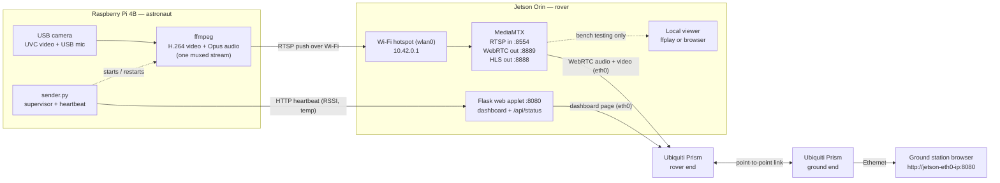

# astronaut-streamer — Implementation Plan

> **Status:** plan, nothing implemented yet. The first round of questions is
> answered (see [§9 Decisions](#9-decisions)). Items still marked *(assumed)*
> wait on the [remaining questions](#10-remaining-questions).

## 1. Goal

Send live **video + audio** from a USB camera on a **Raspberry Pi 4B**
("astronaut" unit) over Wi-Fi to a hotspot hosted by an **NVIDIA Jetson Orin
(AGX or Nano)** ("rover"). Then:

- the Jetson **serves a web page** on an open port so a **ground station**
  can open `http://<jetson-ip>:<port>` in a normal browser and watch and
  listen. The ground station reaches the Jetson over a point-to-point
  **Ubiquiti Prism** link with a horn antenna on each end. This is how the
  feed is normally used.
- the Jetson can also **watch and listen** locally, for bench testing.

Audio is **one-way** (astronaut → ground). Nothing is recorded. The Pi runs
**Ubuntu 22.04 Desktop**; the Jetson is an **Orin on JetPack 6** (Ubuntu
22.04). Priority: **simplest thing that works reliably**.

### Acceptance criteria (proposed)

| # | Criterion | Target |
|---|---|---|
| A1 | Ground station sees **and hears** the feed in Chrome or Firefox, no plugins | 1 click (needed to allow audio) |
| A2 | Latency from camera to ground-station screen, over the Prism link | < 500 ms |
| A3 | Audio/video offset after 1 h of streaming | < ~100 ms (lip sync looks right) |
| A4 | Automatic recovery after Wi-Fi drop, camera replug, or reboot of either box | Stream back ≤ 10 s after cause clears, nobody touches anything |
| A5 | Boots straight into streaming, no keyboard/monitor needed | both devices |
| A6 | Pi stays cool under continuous streaming | no throttling in a 30 min soak |

## 2. Recommended architecture

Use proven media tools to move the audio/video, and use Python/Flask for the
parts we write: the sender supervisor on the Pi and the web page on the Jetson.



Pieces:

1. **Pi (sender):** `ffmpeg` reads the camera (MJPEG) and the camera's
   microphone (ALSA). It encodes **H.264 + Opus**, both stamped against the
   same clock, and **pushes** one RTSP stream to the Jetson's fixed hotspot IP.
   `sender.py` (Python standard library only) finds the devices, waits for the
   Jetson, restarts ffmpeg when it fails, and posts a small health heartbeat.
   It runs as a systemd service.
2. **Jetson (media server):** [MediaMTX](https://github.com/bluenviron/mediamtx)
   is a single static arm64 binary configured with one YAML file. It
   takes in the RTSP stream and re-serves it to any number of viewers as
   **WebRTC** (low latency, audio and video in sync) and **LL-HLS** (fallback).
   It never re-encodes, so CPU load is near zero. That matters because the
   **Orin Nano has no hardware video encoder**
   ([NVIDIA docs](https://docs.nvidia.com/jetson/archives/r36.3/DeveloperGuide/SD/Multimedia/SoftwareEncodeInOrinNano.html)),
   and this design never needs one.
3. **Jetson (web applet):** a small **Flask** app on `0.0.0.0:8080`, served by
   `waitress`. It provides the dashboard page with the player, a **click to
   start audio** button (browsers block autoplay with sound), and link-status
   badges. It also exposes `/api/status`, built from the MediaMTX API plus the
   Pi heartbeat.
4. **Jetson (local view, bench testing only):** `ffplay` reads the same
   stream from `rtsp://127.0.0.1:8554/astronaut`.

### Why not Flask on both ends?

Flask was the first idea, so here is the comparison:

| | **A — Flask + MediaMTX (recommended)** | **B — Flask on both ends (pure Python)** |
|---|---|---|
| How it works | Pi pushes 1 muxed H.264+Opus stream; Flask only serves the page | Pi Flask serves MJPEG `/video` + a separate audio endpoint; Jetson Flask pulls and re-serves both |
| A/V sync | Synced: one stream with shared timestamps | Two independent streams that drift apart; sync must be built by hand |
| Browser audio | WebRTC: ~0.2–0.5 s, same as video | HTTP audio stream: 1–3 s behind video, or WebSocket + custom Web Audio JS |
| Wi-Fi bandwidth (720p30) | ~1.5–2.5 Mbps | ~10–25 Mbps of MJPEG, worse range |
| Pi → Jetson direction | Pi pushes to a **fixed** IP (10.42.0.1) | Jetson has to find the Pi's **DHCP-assigned** IP and pull |
| Reconnects / many viewers | Handled by MediaMTX / WebRTC | All custom code |
| Code we write | `sender.py`, Flask app, config files | Capture, framing, relay, audio player, sync |

Flask is a good fit for the page and the status API. It is a poor fit for
moving live media. The Pi still runs Python (`sender.py`); it just doesn't
need a web server, because nobody browses to the Pi. If we later want a
control page on the Pi (change resolution, restart), a tiny Flask app can be
added there without changing anything else.

### Why not OBS?

OBS was considered for the sender. It doesn't fit on the Pi or the Jetson:

- It's a desktop app that needs OpenGL 3.3, which the Pi 4 only runs through
  a `MESA_GL_VERSION_OVERRIDE` workaround. It's built for a person at the
  controls, not a headless box that has to recover by itself.
- It can't use the Pi's or the Jetson's hardware encoders, so it encodes in
  software and also spends CPU drawing scenes.
- Its usual RTMP output carries AAC audio. The browser's WebRTC player needs
  Opus and MediaMTX doesn't convert, so the ground station would get **no
  sound**. OBS's WHIP output (Opus) fixes this but needs OBS 30+, newer than
  Ubuntu 22.04's package.
- It only *sends* streams. The Jetson would still need MediaMTX and Flask.

Where it can help: on the **ground-station laptop**, as an optional extra. An
OBS Media Source on `rtsp://<jetson-eth0-ip>:8554/astronaut` can add overlays,
show the feed next to the rover's other cameras, or restream for outreach,
with no change to the Pi or the Jetson.

## 3. Components in detail

### 3.1 Networks

**Astronaut ↔ rover: Jetson hotspot**

- Create the hotspot with NetworkManager (already on JetPack 6 / Ubuntu 22.04)
  as a saved connection that comes up automatically at boot:
  ```bash
  sudo nmcli con add type wifi ifname wlan0 con-name astro-hotspot autoconnect yes \
    ssid ASTRO-LINK 802-11-wireless.mode ap 802-11-wireless.band bg \
    802-11-wireless.channel 6 ipv4.method shared ipv4.addresses 10.42.0.1/24 \
    wifi-sec.key-mgmt wpa-psk wifi-sec.proto rsn wifi-sec.pairwise ccmp \
    wifi-sec.group ccmp wifi-sec.psk '<password>'
  ```
  `ipv4.method shared` runs DHCP for the Pi, so the Jetson is always
  **10.42.0.1** on this link *(assumed — change it if this subnet clashes with
  the rover network)*.
- Turn off Wi-Fi power saving on **both** ends
  (`/etc/NetworkManager/conf.d/wifi-powersave.conf` → `wifi.powersave = 2`,
  or `iw dev wlan0 set power_save off`). Power saving causes periodic
  latency spikes on streaming links.
- Band and channel: **2.4 GHz channel 6** *(decided)*. It has the best
  range, and it keeps the hotspot out of the Prism link's band if that link
  is 5 GHz (PrismStation 5AC; confirm in R2). Set the regulatory domain
  (`iw reg set US`). Mount the Jetson's Wi-Fi antennas away from the Prism
  horn.
- Check first that the Jetson's Wi-Fi card supports AP mode:
  `iw list | grep -A10 "Supported interface modes"` must list `AP`.

**Rover ↔ ground: Ubiquiti Prism link**

- The Jetson's Ethernet port (`eth0`) plugs into the rover-end Prism; the
  ground-station laptop plugs into the ground-end Prism.
- Give the Jetson a **static IP on `eth0`** so the ground station can
  bookmark `http://<jetson-eth0-ip>:8080`. The Flask app also prints the URL
  at startup.
- Run the radios in **bridge mode** (airMAX "Bridge" network mode). The
  laptop and the Jetson are then on one subnet with no NAT, and WebRTC
  connects directly with no extra settings. If the radios run in router mode
  instead, add the Jetson's outside address to `webrtcAdditionalHosts`
  *(R1)*.
- Bandwidth: each ground-station viewer pulls ~2 Mbps over the link,
  alongside ROS2 and whatever else the rover sends. A Prism link has far
  more capacity than that at short range; Phase 6 checks it at competition
  distance.
- **Keep ROS2 DDS traffic off the hotspot.** By default DDS uses every
  interface, and Wi-Fi sends multicast at its slowest rate, so DDS discovery
  traffic can use up the astronaut link's airtime. Limit DDS to `eth0` (or
  `lo`) in the ROS2 middleware config.

### 3.2 Pi sender

**Packages:** `ffmpeg v4l-utils alsa-utils` (apt). No pip packages.

**Ubuntu Desktop on the Pi** *(decided)*. Three things to handle:
- **Wi-Fi:** NetworkManager is already installed. The installer saves the
  hotspot (`nmcli dev wifi connect ASTRO-LINK password …`) with autoconnect
  and the highest priority, so the Pi doesn't join a known lab/home network
  instead. It also turns off Wi-Fi power saving.
- **Mic access:** the desktop's PulseAudio can hold the USB mic open, and
  then ffmpeg's direct ALSA open fails with "Device or resource busy".
  `sender.py` runs as a system service (no desktop login needed) and opens
  the mic through ALSA. Phase 0 checks for the busy error.
- **CPU:** the desktop takes CPU and RAM away from encoding. Recommended for
  missions: boot to text mode (`sudo systemctl set-default multi-user.target`).
  With no desktop session, PulseAudio isn't running to grab the mic either.
  Switch back with `graphical.target` for setup work.

**Device discovery** (`sender.py`):
- Camera: use the stable `/dev/v4l/by-id/usb-<name>-video-index0` path, not
  `/dev/videoN`. On a Pi, `/dev/video10–18` are the Pi's own codec/ISP nodes,
  and each UVC camera creates two nodes (video + metadata).
- Mic: match the camera's USB name in `/proc/asound/cards` and use
  `plughw:CARD=<name>,DEV=0`. Card numbers change between boots; names don't.
  `plughw` lets ALSA convert sample rate and channel count for us.
- Check that the requested mode exists (`v4l2-ctl --list-formats-ext`). If it
  doesn't, fall back to the closest MJPEG mode.

**Encode/push command** (starting point; tuned in Phase 2):
```bash
ffmpeg -hide_banner -loglevel warning \
  -f v4l2 -thread_queue_size 512 -input_format mjpeg -video_size 1280x720 -framerate 30 \
  -use_wallclock_as_timestamps 1 -i /dev/v4l/by-id/usb-<cam>-video-index0 \
  -f alsa -thread_queue_size 1024 -ac 1 -i plughw:CARD=<cam>,DEV=0 \
  -c:v libx264 -preset ultrafast -tune zerolatency -profile:v baseline -pix_fmt yuv420p \
  -b:v 2M -maxrate 2M -bufsize 1M -g 30 -bf 0 \
  -af aresample=async=1 -c:a libopus -b:a 32k -ar 48000 -ac 1 -application voip \
  -f rtsp -rtsp_transport tcp rtsp://10.42.0.1:8554/astronaut
```
- Video is **H.264 constrained-baseline, no B-frames, keyframe every 1 s**.
  Every browser can decode it over WebRTC, a new viewer starts within about
  1 s, and the picture recovers quickly after packet loss.
- Audio is **Opus**, which WebRTC requires (MediaMTX doesn't transcode).
  `aresample=async=1` corrects the mic's clock drifting against the camera's
  over long runs.
- **Hardware encoder:** try `-c:v h264_v4l2m2m -pix_fmt yuv420p` first (the
  Pi 4's encoder at `/dev/video11`). It has worked on Pi kernels, but it hasn't
  been confirmed on Ubuntu 22.04 for Pi, so Phase 0 tests it. If it fails,
  use `libx264 ultrafast`: about 1–2 Pi 4 cores at 720p30, much less at 480p.
- Transport: **RTSP over TCP** to begin with (simple, never corrupts frames).
  If field tests show latency creeping up on a weak link, switch to **SRT**
  (`srt://10.42.0.1:8890?streamid=publish:astronaut&latency=200000`), which
  limits latency on lossy links. This becomes one config setting in
  `sender.py`.

**Supervisor behaviour** (`sender.py`):
1. Load `config/astronaut.env` (SSID, Jetson IP, resolution, bitrate,
   transport).
2. Wait until `10.42.0.1:8554` accepts a TCP connection (hotspot is up).
3. Find devices → build the ffmpeg command → start it. Read
   `-progress pipe:1` to see live fps and bitrate.
4. If ffmpeg exits or stalls (no progress for 5 s), kill it, wait with
   backoff (1, 2, 4 … max 10 s), **find the devices again** (handles a
   replugged camera), and restart.
5. **Mic missing, camera present:** stream video only and report it.
   **Camera missing:** keep retrying and report it. *(assumed)*
6. Every 2 s, `POST` a heartbeat to `http://10.42.0.1:8080/api/heartbeat`:
   Pi IP, Wi-Fi RSSI and bitrate (`iw dev wlan0 link`), CPU temperature,
   throttle flags (`vcgencmd get_throttled`), ffmpeg fps and bitrate, device
   status.
7. `--test-pattern` mode (`testsrc` + `sine` tone) to test the Jetson side
   without a camera.
8. Runs as `astronaut-sender.service` (`Restart=always`, starts after
   `network-online.target`) and logs to journald.

### 3.3 Jetson media server — MediaMTX

- Download a **pinned** release of the `linux_arm64` binary. Keep a copy so
  the install also works offline. Install to `/usr/local/bin/mediamtx` and run
  it as `mediamtx.service`.
- `jetson/mediamtx.yml` (sketch):
  ```yaml
  api: yes
  apiAddress: 127.0.0.1:9997        # status API — localhost only, Flask reads it
  rtmp: no
  srt: yes                          # optional low-latency transport for lossy Wi-Fi
  webrtcIPsFromInterfacesList: [eth0, wlan0]   # skip docker/virtual interfaces
  webrtcAdditionalHosts: []         # only needed if the Prism radios do NAT (R1)
  paths:
    astronaut:
      source: publisher
      overridePublisher: yes        # a reconnecting Pi replaces its own stale session
      record: no                    # decided: view only, no recording
  ```
- MediaMTX's defaults (checked against upstream `mediamtx.yml`): RTSP `:8554`,
  HLS `:8888`, WebRTC HTTP `:8889`, WebRTC ICE **UDP `:8189`**, SRT
  `:8890/udp`. WebRTC tells the browser which Jetson IPs to try. Limiting it
  to `eth0` and `wlan0` leaves out Docker and other virtual interfaces,
  which only slow the connection down. With bridge-mode radios nothing else
  is needed. Interface names are set in `astronaut.env`.

### 3.4 Jetson web applet — Flask

**Packages:** `flask waitress requests` in a venv.

| Route | Purpose |
|---|---|
| `GET /` | Dashboard: video player, **▶ Start (with audio)** button, status badges (feed live/offline, bitrate, uptime, viewer count), Pi health (RSSI, temp, throttling), WebRTC ↔ HLS toggle |
| `GET /api/status` | JSON from the MediaMTX API (`/v3/paths/get/astronaut`) plus the latest Pi heartbeat |
| `POST /api/heartbeat` | Receives the Pi's health JSON |
| `GET /healthz` | Liveness check for systemd/monitoring |

Player approach:
- **Milestone 1:** embed MediaMTX's own player in an `<iframe>`. The iframe
  URL is built in JS from `window.location.hostname`, so the page works with
  whatever IP the ground station used to reach the Jetson. Nothing is
  hardcoded.
- **Milestone 2:** our own `<video>` element fed by WHEP (about 60 lines of JS
  talking to `http://<host>:8889/astronaut/whep`). We control mute/unmute, a
  "NO SIGNAL — reconnecting" overlay, automatic retry, and HLS fallback.
- At startup, log every IPv4 address with a ready-to-click URL
  (`Ground station: open http://192.168.1.50:8080`), like
  `start-remote-kiosk.sh` does.

The page is served over plain HTTP. Receiving WebRTC doesn't need HTTPS; only
camera/mic *capture* does, and audio is one-way *(decided)*, so plain HTTP is
enough.

### 3.5 Jetson local viewing (bench testing only)

- `make astronaut view` →
  `ffplay -fflags nobuffer -flags low_delay -framedrop -rtsp_transport tcp rtsp://127.0.0.1:8554/astronaut`
  (video + audio in one window, software decode is fine on Orin).
- Or open `http://localhost:8080` in a browser on the Jetson to test the
  ground-station page itself.
- Not installed as a service: normal use is through the ground station.
  Plug a monitor and headset into the Jetson when bench testing.

## 4. Ports

| Port | Proto | Service | Must be reachable from |
|---|---|---|---|
| 8080 | TCP | Flask dashboard | Ground station (Prism link, `eth0`) |
| 8889 | TCP | MediaMTX WebRTC signalling (WHEP) | Ground station (Prism link, `eth0`) |
| 8189 | **UDP** | MediaMTX WebRTC media | Ground station (Prism link, `eth0`) |
| 8888 | TCP | MediaMTX LL-HLS (fallback) | Ground station (Prism link, `eth0`) |
| 8554 | TCP | MediaMTX RTSP ingest (+ RTSP out for `ffplay`/OBS) | Pi (hotspot); ground-station OBS if used |
| 8890 | UDP | MediaMTX SRT ingest (optional) | Pi (hotspot) |
| 9997 | TCP | MediaMTX API | localhost only |

The Jetson already uses **5000/5001** (F´ GDS) and **5900** (spectrometer VNC),
so Flask stays off Flask's default port 5000. If `ufw` is active, the
installer opens the ports above.

## 5. Proposed layout

Lives in this repo as `astronaut-streamer/`, next to `RunScienceSpectrometer/`
*(assumed — could become its own repo/submodule later, see R5)*.

```
astronaut-streamer/
├── PLAN.md                     # this file
├── README.md                   # quick start + troubleshooting (Phase 7)
├── config/
│   └── astronaut.env           # SSID/PSK, Jetson IP, ports, resolution, bitrate, transport
├── pi/
│   ├── pi_install_me.sh        # apt deps, join hotspot, power-save off, install service
│   ├── probe_devices.py        # Phase 0: list cameras, modes, mics, HW encoder check
│   ├── sender.py               # supervisor: discovery → ffmpeg → restart/backoff → heartbeat
│   └── astronaut-sender.service
├── jetson/
│   ├── jetson_install_me.sh    # hotspot, MediaMTX (pinned), venv, services, ufw
│   ├── hotspot.sh              # create/remove the nmcli hotspot connection
│   ├── mediamtx.yml
│   ├── mediamtx.service
│   ├── app.py                  # Flask web applet
│   ├── templates/index.html
│   ├── static/player.js        # WHEP player, unmute, reconnect, HLS fallback
│   ├── astronaut-web.service
│   └── local_view.sh           # ffplay viewer (bench testing)
└── tests/
    └── test_sender_cmd.py      # unit tests for device parsing + ffmpeg command building
```

Top-level `Makefile` gains targets in the same style as `make science`:
`make astronaut pi`, `make astronaut jetson`, `make astronaut view`. The top-level
README's repository layout gets an entry.

## 6. Phases

| Phase | Work | Exit criteria |
|---|---|---|
| **0 — Bench check** | On the Pi: `v4l2-ctl --list-devices / --list-formats-ext`, `arecord -l`, record 5 s through ALSA **while logged into the desktop** (catches PulseAudio "device busy"), test `h264_v4l2m2m`. On the Jetson: `cat /etc/nv_tegra_release`, `iw list` shows AP. Bring the hotspot up, join it from the Pi, run `iperf3` at 5 / 20 / 50 m and through obstacles. Prism link: confirm bridge mode, ping the Jetson's `eth0` IP from the ground laptop. | Table of camera modes; HW-encoder yes/no; mic opens with the desktop running; measured Wi-Fi throughput vs distance; ground laptop reaches the Jetson |
| **1 — Media server + test pattern** | Install MediaMTX; from the Pi, push `ffmpeg -re -f lavfi -i testsrc … -f lavfi -i sine …`; open `http://10.42.0.1:8889/astronaut` on a laptop on the hotspot | Test pattern + tone play in the browser |
| **2 — Real camera, manual command** | Run the command from §3.2 by hand; tune resolution/bitrate; measure Pi CPU/temp, **latency** (film a stopwatch next to the viewer), **sync** (clap test) | A2, A3, A6 met at the chosen resolution |
| **3 — `sender.py` + systemd** | Discovery, wait-for-Jetson, backoff restart, video-only fallback, heartbeat, test-pattern mode, unit tests | Unplug/replug camera, kill Wi-Fi, reboot each box in either order → A4, A5 |
| **4 — Flask web applet** | Dashboard, `/api/status`, heartbeat endpoint, click-to-start audio; iframe player first, then WHEP player + HLS fallback | A1 from a laptop on the hotspot **and** from the ground station over the Prism link |
| **5 — Bench viewer** | `local_view.sh` (ffplay), Makefile targets | Feed visible + audible on the Jetson with a monitor + headset plugged in |
| **6 — Field soak** | 2 h continuous run; walk out of hotspot range and back; drop and restore the Prism link; 3+ simultaneous viewers; Prism link at competition distance alongside normal rover traffic (ROS2, GDS) | All acceptance criteria hold in the field |
| **7 — Docs** | `README.md`, troubleshooting, top-level README + Makefile | Someone new can set it up from the README alone |

## 7. Failure modes and planned behaviour

| Situation | What happens |
|---|---|
| Jetson boots before Pi | Hotspot + MediaMTX + Flask come up; dashboard shows **"Waiting for astronaut feed"** |
| Pi boots before Jetson | `sender.py` waits for `10.42.0.1:8554`, then starts streaming |
| Wi-Fi drops / out of range | ffmpeg errors out → supervisor retries with backoff; MediaMTX `overridePublisher` accepts the new session even if the old one hasn't timed out yet; viewers see "reconnecting" and resume automatically |
| Camera unplugged / replugged | ffmpeg exits → devices found again via `by-id` path → resumes |
| Mic missing or fails | Video continues alone; dashboard flags **"NO AUDIO"** *(assumed)* |
| PulseAudio on the Pi desktop holds the mic | ffmpeg can't open it → same as above; fixed by booting to text mode (§3.2) |
| Prism link drops (out of range, antenna knocked off alignment) | Pi → Jetson stream keeps running; the ground-station page shows "reconnecting" and resumes when the link returns |
| Pi overheats / under-voltage | Heartbeat shows throttle flags; supervisor can step down resolution/bitrate (optional) |
| Ground station opens page before stream exists | Player waits and connects when the stream appears |
| Browser blocks autoplay with sound | **▶ Start** button; video can start muted, audio after one click |
| Ground network blocks UDP / NAT in between | Set `webrtcAdditionalHosts`, or the page falls back to **HLS** (TCP only, ~2–4 s latency) |
| Many viewers | MediaMTX copies packets without re-encoding; each viewer adds ~2 Mbps on the Prism link (see R3) |
| Hotspot subnet clashes with rover network | `10.42.0.0/24` is configurable in `astronaut.env` |
| Port already in use on the Jetson | All ports configurable; defaults avoid GDS 5000/5001 and VNC 5900 |
| No internet in the field | Installers need internet once; MediaMTX binary can be vendored; Pi needs no pip packages |
| Pi clock wrong (no RTC, no internet) | Doesn't affect streaming (timestamps are relative); log timestamps are fine on the Jetson side. Optional: Jetson serves NTP to the Pi via chrony |

## 8. Risks

| Risk | Mitigation |
|---|---|
| Jetson Wi-Fi chipset/driver doesn't support AP mode well | Phase 0 `iw list` check; fallback: cheap USB Wi-Fi adapter known to do AP, or a small travel router |
| Pi 4 can't encode 720p30 in software and the HW encoder doesn't work on Ubuntu 22.04 | Drop to 640×480 or 960×540 @ 30; or 720p @ 15 |
| A/V sync drifts with ffmpeg's separate v4l2/ALSA inputs | Wallclock timestamps + `aresample=async=1`; if the clap test still fails, switch the sender to a GStreamer pipeline (shared pipeline clock) — same RTSP output, nothing else changes |
| Latency creeps up over TCP on a weak link | Switch transport to SRT (config flag) |
| Prism link throughput at competition distance, shared with other rover traffic | Measure in Phase 6; bitrate is one setting; 480p @ ~800 kbps is still usable |
| ROS2 DDS multicast floods the hotspot | Limit DDS to `eth0`/`lo` (§3.1) |

## 9. Decisions

Answered 2026-11-04.

| # | Question | Decision |
|---|---|---|
| D1 | How does the ground station reach the Jetson? | Point-to-point **Ubiquiti Prism** link, horn antenna on each end |
| D2 | Which Jetson / JetPack? | **Orin on JetPack 6** (Ubuntu 22.04); AGX or Nano both work with this design |
| D3 | Is the Jetson's Wi-Fi free to be the hotspot? | **Yes**, `wlan0` is only for the astronaut link |
| D4 | One-way or two-way audio? | **One-way** (astronaut → ground) |
| D5 | Range / band | Default accepted: < 50 m, line of sight, **2.4 GHz ch 6** |
| D6 | Resolution / frame rate | Default accepted: **720p @ 30 fps, ~2 Mbps**; drop to 480p if the Pi can't keep up |
| D7 | Local viewing on the Jetson | **Bench testing only**; normal use is through the ground station |
| D8 | Recording | **None**; view only, at the ground station, forwarded by the Jetson |
| D9 | Pi image | **Ubuntu 22.04 Desktop** |

## 10. Remaining questions

Smaller ones; the plan works with the defaults.

- **R1 — Prism addressing:** are the radios in **bridge** mode, and what
  static IP/subnet should the Jetson's `eth0` have on the rover network?
  *Default: bridge mode; Jetson IP picked to fit the existing rover subnet.*
- **R2 — Prism band:** is the Prism link on 5 GHz? If it's on 2.4 GHz, the
  hotspot should move to 5 GHz instead. *Default: 5 GHz, hotspot stays on
  2.4 GHz.*
- **R3 — Viewers and password:** how many people watch at once, and should
  the page need a password? *Default: ≤ 3 viewers, no password.*
- **R4 — Pi power and housing:** battery? Inside a suit or enclosure (heat)?
  *Default: 5 V / 3 A supply, open air.*
- **R5 — Repo:** folder in this repo, or a separate `astronaut-streamer` repo
  pulled in as a submodule? *Default: folder in this repo.*
- **R6 — Mic failure:** keep sending video only, or treat it as a fault?
  *Default: video only, flagged on the dashboard.*
- **R7 — More cameras later?** *Default: one; MediaMTX paths are named so more
  can be added (`/astronaut2`).*
